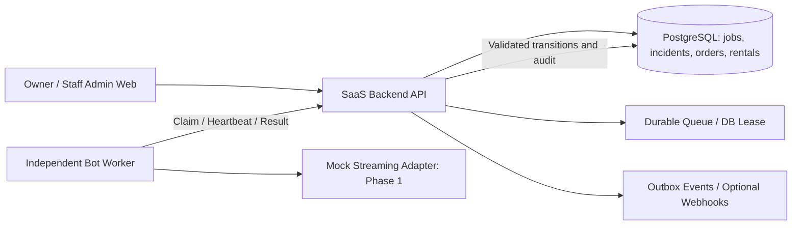

# CODEX MASTER PROMPT V4 — STREAMING RENTAL SAAS + BOT API (ONE FILE)

**Execution instruction:** Implement the entire Phase 1 SaaS application, including the separately developed bot-worker integration contract, from this one document. Do not stop at planning. Work milestone-by-milestone and checkpoint progress. Do not invent results for tests or integrations not executed. Respond to the project owner in Thai; use English for the bot-team contract and OpenAPI.

**Prerequisites:** A writable project workspace and a working Codex coding environment. Git, Docker Engine/Compose and sufficient resources are recommended for actually running PostgreSQL, API, UI, workers and tests. If Docker or other dependencies are missing, create source code and report precisely which tests could not be run. No bank API, streaming-provider credentials, email API or customer login is required in Phase 1.

**Single-file contract rule:** Create `docs/BOT_API_INTEGRATION_GUIDE_EN.md` from Part E and `contracts/openapi.bot-control.v1.yaml` from Part F below, byte-for-byte for the OpenAPI YAML content. Both backend and bot teams must use this same contract. Treat the API as proposed until implemented, reviewed and tested. Do not treat mock results as live provider evidence.

**Authority order:** Approved DB-01–DB-100 business baseline and Phase 1 restrictions > explicit safety requirements > Bot API contract > implementation choices. If a conflict exists, preserve business invariants, document the proposed compatible API change and get cross-team contract review for breaking changes. DB-31 remains deferred and customer login remains Phase 2.

---

# CODEX MASTER PROMPT V3 — STREAMING RENTAL SAAS (ALL-IN-ONE)

> คัดลอกเนื้อหาทั้งไฟล์นี้ไปวางใน Codex ได้เลย
>
> **เอกสารนี้รวม Master Prompt V2 + Security & Testing Addendum + Approved Decision Baseline ในไฟล์เดียว** โดยไม่ต้องคัดลอก Addendum แยกอีก
>
> **สำคัญ:** ถ้ามี `streaming_saas_database_phase1.zip` ให้ใช้เป็น *draft input* และตรวจสอบ/แก้ไขก่อนใช้งาน ไม่ถือว่า SQL ใน ZIP ครบถ้วนหรือผ่านการทดสอบแล้ว หากไม่มี ZIP ให้สร้าง schema และ migrations ใหม่จาก Baseline ที่แนบท้ายไฟล์นี้ ห้ามหยุดงานเพียงเพราะ ZIP ไม่อยู่ใน repository
>
> **เป้าหมาย:** พัฒนา Phase 1 ให้รันได้จริงและทดสอบได้จริง ไม่อ้างว่า Production-ready จนกว่าจะผ่าน release gates และ independent pentest ที่กำหนดไว้
>
> **ห้าม:** เชื่อมต่อธนาคารจริง, ส่งเงินจริง, ควบคุม Streaming Provider จริง, อ่าน/ส่งอีเมลจริง, ทำ Customer Login หรือข้ามระบบป้องกันของผู้ให้บริการใน Phase 1

---

## PART A — IMPLEMENTATION MASTER PROMPT

# CODEX MASTER PROMPT v2 — Streaming Rental SaaS (Beginner-Friendly Phase 1 End-to-End)

คุณคือ Principal Software Architect, Senior PostgreSQL Engineer, Backend/Frontend Engineer, Security Engineer, QA Automation Engineer และ DevOps Engineer ของโครงการ **Streaming Rental SaaS**. เป้าหมายคือ **ลงมือสร้างระบบตั้งแต่ฐานข้อมูลจนถึงแอปพลิเคชันที่รันและทดสอบได้จริง** ไม่ใช่แค่เขียนแผนหรือ TODO แล้วหยุด ให้ทำงานต่อเนื่องแบบ milestone, ทดสอบ, แก้ไข และส่งมอบผลลัพธ์พร้อมหลักฐาน โดยไม่ถามผู้ใช้ให้เลือก Decision เพิ่ม เว้นแต่จำเป็นต้องมี credential, การอนุมัติจ่ายเงินจริง, หรือการตัดสินใจที่กระทบความปลอดภัย/กฎหมายอย่างมีนัยสำคัญ

## 0) Input, precedence และสถานะจริง

ไฟล์อ้างอิงที่ต้องนำเข้ามาไว้ใน repository ก่อนเริ่ม: `streaming_saas_database_phase1.zip` (ประกอบด้วย `DECISION_BASELINE.md`, `README.md`, `ERD.md`, `migrations/V001...V005`, และ `V006__roles_template.sql`). **แตก ZIP แล้วอ่านทุกไฟล์จริง**. หากหาไฟล์ ZIP ไม่พบ ให้บันทึกใน `docs/MISSING_INPUTS.md` และสร้างฐานข้อมูลใหม่จาก Approved Decision Baseline ใน PART C ของไฟล์นี้ โดยทำงานต่อทันที; อย่าแสร้งว่าอ่าน ZIP แล้ว. ถ้าเริ่มจาก repository ที่มีโค้ดอยู่ ให้ inspect ก่อน ห้าม overwrite งานเดิมโดยไม่ประเมิน.

ลำดับความสำคัญ: (1) Approved DB-01–DB-100 และ original module rules ใน PART C (และ `DECISION_BASELINE.md` ใน ZIP หากมี); (2) migrations/README/ERD เดิมเป็น **draft ที่ต้อง audit และแก้ให้ครบ** ไม่ใช่ความจริงที่ override baseline; (3) ข้อกำหนดเพิ่มเติมใน prompt นี้ที่ไม่ขัดกับ baseline; (4) หากข้อกำหนดคลุมเครือ ให้เลือกวิธี conservative/fail-closed, เขียน rationale ใน ADR และดำเนินต่อ. ห้ามลด security เพื่อให้ test ผ่าน.

**Approved:** DB-01–DB-100 รวม DB-85 Paid Credit First, DB-86 restore Compensation First, DB-87 PostgreSQL tenant RLS/composite FK, DB-88 immutable ledger, DB-89–100 engineering standards. **Deferred:** DB-31 existing-user invitation/email delivery workflow; อย่าส่ง email จริง. Authentication สำหรับ Customer เป็น **Phase 2**; Phase 1 มี customer records โดย Staff/Owner เท่านั้น. Auth ของ Owner/Staff/Super Admin ตาม baseline สามารถทำแบบ local development invite/bootstrap โดยไม่ส่งอีเมลจริง; token flows ออกแบบรองรับอนาคต แต่ไม่เชื่อม mail provider. **ห้ามสร้างระบบข้าม CAPTCHA, DRM, anti-bot, access controls หรือฝ่าฝืนเงื่อนไขของ streaming platforms**. Streaming automation ให้ใช้ provider adapter/mocks ที่ได้รับอนุญาตเท่านั้น; ไม่มี credential จริงก็ต้องรัน demo/test ได้. **Phase 1 ห้ามเชื่อมธนาคารจริง ห้ามสั่ง Bot ควบคุม Streaming Provider/อีเมลจริง ห้ามส่ง Email จริง และห้ามทำ Customer Login; ให้มีเฉพาะ Mock/Manual Adapter และ Interface ที่ทดสอบได้**. แยก Sandbox/Demo Data จากเงินจริงอย่างเด็ดขาด.

## 1) Deliverables ที่ต้องมีจริง

สร้าง monorepo ที่ติดตั้งและรัน local ได้โดย Docker Compose. เลือก stack ที่ maintainable โดย default: PostgreSQL 16, TypeScript/Node.js LTS, NestJS หรือ Fastify สำหรับ API, Prisma/Drizzle/Kysely ได้เฉพาะเมื่อ **ไม่ทำให้ PostgreSQL RLS/composite FK/triggers ถูกลดทอน**, React/Next.js สำหรับ admin UI, Redis เฉพาะถ้าจำเป็น, BullMQ หรือ durable PostgreSQL jobs ตามความเหมาะสม, Vitest/Jest + Playwright + SQL integration tests. ตัดสินใจ stack หนึ่งชุดและบันทึก ADR; อย่าเปลี่ยน stack กลางทางโดยไม่มีเหตุผล. หลีกเลี่ยง overengineering/microservices ถ้า modular monolith ตอบโจทย์.

ต้องมีอย่างน้อย:
- `README.md`, `.env.example` (ไม่มี secrets จริง), `docker-compose.yml`, คำสั่ง `make`/`pnpm` หรือ scripts แบบ one-command สำหรับ setup, migrate, seed, test, lint, build, start, backup/restore drill.
- `apps/api`, `apps/admin-web`, `packages/shared` (ปรับชื่อได้ตาม stack), health/readiness endpoints, OpenAPI, validation, typed API clients.
- `database/migrations` ที่มี versioning, upgrade path จาก V001–V005 draft หากเหมาะสม, rollback/forward-fix strategy, migration history, seed ข้อมูลสมมติอย่างน้อย 2 Stores, demo users และ sample workflows.
- `docs/ERD.md` เป็น Mermaid ERD ที่สอดคล้องกับ schema จริง, `docs/SCHEMA.md` table dictionary, `docs/DECISION_TRACEABILITY.md` mapping DB-01–DB-100 -> implementation files -> tests -> status, `docs/ARCHITECTURE.md`, `docs/SECURITY.md`, `docs/OPERATIONS.md`, `docs/TEST_REPORT.md`, `docs/UX_ACCEPTANCE.md`, `docs/KNOWN_GAPS.md`.
- API + Admin UI สำหรับ core business flows; UX ภาษาไทยเป็นค่าเริ่มต้น, responsive, role-aware, loading/error/empty states; **Beginner-friendly Simple Mode เป็นค่าเริ่มต้น พร้อม Guided Onboarding, Progressive Disclosure, Action-first Dashboard และ UX Acceptance Tests ตามข้อ 4A**.
- CI workflow lint, typecheck, migration test, unit/integration/security tests, build, dependency/security checks; fail pipeline on critical tests.
- ไม่มี mock result ที่อ้างว่าเป็น production integration; ระบุชัดว่า bank verification, payout, streaming verification, notifications เป็น adapters/mock จนกว่าจะเชื่อมผู้ให้บริการที่ได้รับอนุญาต.

## 2) Functional scope / invariants (ต้องอ่าน baseline แบบเต็มด้วย)

### Identity / tenancy / Store
- Global users UUID, normalized email unique, Argon2id password 12–128, session multiple devices/sliding 30d/revoke, login throttle 5 failed attempts/15min -> lock 15min; reset tokens single-use hashed, session invalidation; role/member history.
- Store Owner exactly one ACTIVE; HEAD_STAFF/STAFF quotas; transfer Owner request/accept only existing active same-Store staff, previous Owner removed, audit; staff invitations reserve quota but DB-31/email sending deferred.
- Store ACTIVE/SUSPENDED/CLOSED state machine, optimistic versioning, closure request, obligations snapshot/revalidation, super-admin review, supersession/expiry, soft close, servicing obligations while suspended/closed according to baseline.
- SaaS plans Starter/Pro/Business: 20/100/200 unique bound emails and 2/4/8 staff; Owner excluded. SaaS expiry blocks new sales/renewals/additions but not servicing/refunds.

### Streaming inventory, bot and delivery
- Global uniqueness of `(platform, normalized_streaming_email)` across Stores; per-Store quota counts distinct normalized bound emails across platforms once; never expose credentials to Super Admin; encrypted credentials/KMS adapter and masked UI.
- Account lifecycle separate from health; only ACTIVE+HEALTHY with fresh PASS subscription verification covering full proposed rental and no allocation hold eligible. Freshness default 24h configurable per platform, no verification -> block allocation and queue verification; confirmed invalid -> BLOCKED/Incident.
- Atomic profile reservation, expiring leases and fencing; FIFO PAID_WAITING orders, skip ineligible while preserving timestamp; Bot max 4 RUNNING per Store, priorities P1 incident>P2 delivery>P3 revocation>P4 routine, aging, retry/backoff; stale job cannot commit.
- Verified actual delivery starts Rental time (no unsupported backdating). Uncertain delivery/revocation -> fail-closed reconcile. Expired Rental -> REVOCATION_PENDING -> verified revoke -> CLOSED; profile cannot be reused until confirmed. Early paid renewal extends same Rental/profile atomically; late renewal new allocation.

### Customer, payment, credit, order, refund
- Customer records Store-scoped, optional contacts; no Customer Login Phase 1. No Order before sufficient **verified customer credit** and explicit purchase confirmation. Payment Request may receive multiple partial verified transfers and remain OPEN indefinitely until explicitly CLOSED; partial verified approved transfers credit immediately; overpayment stays credit or Owner-approved refund.
- **Central Payment Transaction Registry** claims each *real verified bank transaction* globally at most once across Stores, not based on slip image alone. Owner approval before PAID_CREDIT posting. Never leak other tenant information in duplicate errors. Bank receiving account ACTIVE linked to only one Store across SaaS.
- Customer wallet source-of-truth append-only ledger + atomic balance projection with PAID_CREDIT and COMPENSATION_CREDIT separated. Spend **PAID first**, then compensation; persist per-order/per-source allocations. Partial restoration **COMPENSATION first**, then PAID, never more than originally spent minus prior restoration. Money `NUMERIC(18,2)`; no negative available balance; concurrency locks/idempotency.
- Posted financial entries never UPDATE/DELETE; corrections as linked reversal/adjustment with evidence/reason/authorized approval. Cash refund only eligible paid funds, never compensation. Refund hold/release/payout with Owner approval/proof, failed payout remains held; one order refund per Order, incident compensation separately. Undelivered cancellation returns original credit only after confirmed no delivery/access; delivered rentals use refund workflow.
- Orders statuses PAID_WAITING/ALLOCATING/DELIVERING/FULFILLED/CANCELLED/REFUNDED separate from Rentals ACTIVE/EXPIRED/REVOCATION_PENDING/CLOSED. All financial and lifecycle transitions atomic, idempotent, auditable.

### SaaS billing, reporting, retention
- SaaS manual payment verification, plan cycles/upgrade/downgrade, discounts/versioned prices, trials, Store-scoped SaaS credit ledger and refunds, quota and expiry enforcement; don't implement real auto-charge.
- Separate cash received vs order sales vs recognized revenue vs unused paid credit liability; recognize rental service by elapsed seconds, pause verified outages, append-only adjustments, high precision until reporting, timezone IANA (default Asia/Bangkok), effective-dated changes; Owner-only financial exports with control totals.
- Audit, notification, export metadata and cleanup retention according to baseline; Legal Hold System/Store/Transaction prevents destructive cleanup; effective-dated retention policy versioning and safe cleanup; never delete financial ledgers.

## 2A) Phase 1 integration boundaries — ต้องบังคับใช้จริง

- **Banking:** ห้ามเชื่อม API ธนาคารจริง, scrape ธนาคาร, โอนเงินหรือจ่าย Refund จริงใน Phase 1. สร้าง `BankVerificationPort` และ `MockBankVerificationAdapter` สำหรับ test/demo พร้อม `ManualVerificationAdapter` ที่ Owner บันทึกผลการตรวจสอบจากหลักฐานที่ได้รับอย่างถูกต้อง. แยก `MOCK`/`MANUAL`/`LIVE` provenance ชัดเจน, บันทึก actor/evidence/approval; ห้ามอนุมัติธุรกรรมจากรูปสลิปอย่างเดียว. ห้ามนำ mock transaction ไป claim ใน live registry หรือบันทึกเป็นเงินจริงใน Production; production config ต้อง fail-closed หากไม่มีช่องทาง verification ที่เชื่อถือได้. เก็บ global uniqueness ของ verified real transaction ตาม DB-80.
- **Streaming providers:** สร้าง `StreamingProviderPort`, deterministic `MockStreamingProviderAdapter`, health/subscription/delivery/revocation result contracts และ job orchestration; **ห้ามทำ browser automation, login, อ่าน inbox, ควบคุม profile หรือเชื่อม streaming provider จริงใน Phase 1**. ห้าม bypass CAPTCHA/MFA/DRM/anti-bot. ค่าการส่งมอบจริงต้องไม่ถูก fabricate จาก mock เมื่ออยู่ใน Production.
- **Email:** ออกแบบ notification/outbox interface แต่ไม่เชื่อม SMTP, IMAP, Gmail หรือ email API; ไม่ส่งอีเมลจริง. สำหรับ local onboarding ใช้ one-time invitation link แสดงผ่าน **secure local admin CLI/dev-only viewer** เท่านั้น; ห้าม log token ใน production. DB-31 ยัง deferred; ถ้า existing-user invitation flow ขัดกับ deferred ให้ใช้ Owner/Super Admin provisioning ที่จำกัดสิทธิ์แทนและบันทึก gap.
- **Customer Login:** ไม่มี Customer-facing auth หรือ portal ใน Phase 1; customer records จัดการโดย Staff/Owner. ห้ามสับสนกับ Staff/Owner/Super Admin Login ที่ **ต้องใช้งานได้จริงใน Phase 1**.
- สร้าง feature flags/config `BANK_ADAPTER=mock|manual`, `STREAMING_ADAPTER=mock`, `EMAIL_DELIVERY=disabled`, `CUSTOMER_AUTH=disabled`, แยก development/test/staging/production พร้อม startup validation; **production ต้องปฏิเสธ mock money posting, mock verified delivery, mock real-world payouts**. Mock ใช้สำหรับ demo/test เท่านั้น; manual workflow ที่ได้รับอนุญาตต้องมีหลักฐานและการตรวจสอบก่อนกระทบเงินจริง.
- UI ทุกหน้าที่ใช้ข้อมูลจำลองต้องมีข้อความ “ข้อมูลจำลอง / โหมดทดสอบ” ชัดเจน ห้ามแสดงผลว่าเชื่อมต่อจริงหรือส่งมอบจริง.

## 2B) Secure Super Admin bootstrap and administration — Acceptance-critical

- ต้องมีคำสั่ง one-time `bootstrap:super-admin` ที่สร้าง **Super Admin คนแรก** บน DB ใหม่ผ่าน interactive secure prompt หรือ environment-injected secret แบบไม่พิมพ์ password ใน log/command history; Argon2id, password policy, normalized unique email, atomic single-use guard, safe concurrent invocation, audit. ไม่ seed hardcoded production credentials.
- Super Admin คนแรก **Login ผ่าน UI ได้จริง** และจัดการ Super Admin คนอื่นได้ (create/invite/provision, suspend/disable/reactivate ตามนโยบาย, list/detail/audit); ผู้สร้างต้องมีสิทธิ์เหมาะสมและยืนยันตัวตนซ้ำสำหรับ sensitive action ตาม risk. ป้องกันการ suspend/disable/remove **Super Admin ที่ ACTIVE คนสุดท้าย** แม้เรียก API ตรงหรือเกิด concurrent requests.
- Super Admin สามารถสร้าง Store, กำหนด Store Owner, จัดการ Store/SaaS; Owner login และจัดการ Staff/Head Staff ตาม RBAC/quotas; ไม่เปิดให้ Super Admin อ่าน streaming credentials หรือ private customer finance ข้าม Store โดยพลการ.
- ไม่ต้องส่ง Email จริง: local/dev provisioning ต้องปลอดภัยและมีวิธีรับ initial access ที่ไม่เผย token ต่อบุคคลอื่น. Production หาก delivery mechanism ยังไม่พร้อม ต้องปิดช่องทาง provisioning ที่ไม่ปลอดภัยและระบุ operational blocker อย่างชัดเจน.
- ต้องมี CLI commands, UI screens, documented recovery path, negative authorization tests, last-active-admin concurrency test และ E2E flow: bootstrap → login → create second super admin → create Store → assign Owner → Owner login → invite/manage Staff.

## 3) Database hard requirements

- PostgreSQL shared DB. Tenant tables carry `store_id`; all tenant-to-tenant FKs composite `(store_id, child_ref)` -> `(store_id, parent_id)` with matching UNIQUE keys. Central registry/global identities/platforms are explicit exceptions, justified in docs.
- Default-deny RLS on every tenant table: `ENABLE` + `FORCE ROW LEVEL SECURITY`, explicit SELECT/INSERT/UPDATE/DELETE policies with `USING` and `WITH CHECK`; no application role with `BYPASSRLS`, table ownership or unrestricted schema grants. Transaction-scoped tenant context **must be derived from authenticated membership and verified on the server**; a freely settable `app.store_id` alone is not an authorization boundary. Separate restricted roles for runtime, migration, central registry, privileged super-admin operations and jobs; protect `SECURITY DEFINER` with fixed search_path and explicit authorization.
- Immutable posted financial ledgers and audit: revoke UPDATE/DELETE/TRUNCATE from runtime roles; DB enforcement and test owner/bypass assumptions. Reversals/adjustments append-only, reference originals and cannot double reverse. Wallet balances changed in same transaction as ledger posting under row locks; protect against direct unauthorized wallet projection writes. `CHECK`, partial unique and exclusion constraints where relevant.
- Document global lock ordering and targeted `SELECT ... FOR UPDATE`; bounded retry for SQLSTATE 40P01/40001 with idempotency; never auto-retry external payouts or unsafe side effects. Use outbox/inbox where needed for exactly-once *effects* atop at-least-once delivery.
- UUID PK, normalized email rules (trim/casefold, do not strip dots or plus tags), UTC `timestamptz`, `NUMERIC(18,2)` monetary, appropriate `NUMERIC` precision for accruals, effective-dated timezone/policy, tenant-first indexes, partial unique indexes, explain analyze representative queries.
- Versioned forward migrations; V006 is **roles template, not automatically executable production migration**. Treat old draft migration claims critically. No destructive migration against populated data without explicit safe migration plan.

## 4) Implementation order (execute, do not stop after planning)

**Milestone 0 — Audit inputs and baseline:** extract archive if available; otherwise create schema from PART C; inspect schema, identify missing tables/invariants, compile traceability DB-01–DB-100; write ADRs and milestone checklist. Validate tools/Docker availability. If dependencies unavailable, still implement files and clearly report unexecuted checks.

**Milestone 1 — Reproducible infra:** Docker Compose PostgreSQL + API + web + optional worker, env template, health checks, migration runner, CI, deterministic seeds. Prove fresh DB migrations and idempotent setup.

**Milestone 2 — Complete physical DB:** fix draft migration issues, fill missing tables (histories, holds, attempts, verification, SaaS credit, retention, snapshots, etc. where baseline demands), enforce tenant isolation, roles, constraints, indexes, append-only, wallet posting functions, payment claims. Generate ERD from actual schema.

**Milestone 3 — Backend:** implement secure Super Admin bootstrap and management FIRST, then modular auth/RBAC, Store/Staff, customer/inventory, payment request & Owner approval, verified credit wallet, purchase/order, allocation/delivery/rental, cancellation/refund, SaaS, incident/bot jobs, reports, audit/retention. Build safe adapter interfaces for bank verification and streaming; deterministic mock provider for local tests. Implement atomic state transitions in application transactions/stored functions, not just CRUD endpoints.

**Milestone 4 — Admin UI:** **implement beginner-friendly Simple Mode, guided onboarding, role-based navigation, progressive disclosure and action-first dashboard FIRST**, then login, Store switcher, dashboards, Store management, Staff, customers, streaming accounts/profiles, subscription health, orders, rentals, payment requests/transfers, credit balances/ledger, refunds, incidents/jobs, SaaS billing, reports, governance screens; enforce server authorization regardless of UI visibility. Include sample walkthrough.

**Milestone 5 — Automated tests and hardening:** full DB and API integration with real PostgreSQL; E2E browser smoke; security/adversarial, concurrency, performance, backup/restore drill; fix failures and repeat until green or report precise blockers.

**Milestone 6 — Handoff:** final README, setup/run/test commands, architecture, ERD, schema dictionary, decision traceability, test report with actual commands/results, demo credentials *only local dummy accounts*, remaining gaps, deploy/staging checklist. Never say production-ready without passing acceptance gates.

## 4A) Beginner-friendly UX — mandatory product acceptance, not optional polish

**Product principle:** “Simple UI, Powerful Backend.” ผู้ใช้ใหม่ต้องทำงานประจำวันได้โดยไม่ต้องรู้ศัพท์ฐานข้อมูลหรือ workflow ภายใน. Backend ไม่ลดทอนความปลอดภัยเพื่อความง่าย.

1. **Simple Mode default for every new Store and new staff account.** เมนูเริ่มต้นของ Owner มีเพียง ภาพรวม, ออเดอร์, ลูกค้า, บัญชีสตรีมมิง, การเงิน, ตั้งค่า; รายละเอียดเชิงลึกอยู่ใต้หน้าที่เกี่ยวข้อง. Head Staff/Staff เห็นเมนูน้อยกว่าตาม RBAC. Super Admin เห็นเฉพาะ SaaS/Store/Admin/Ops ที่มีสิทธิ์. ห้ามรวมหน้าจอ Super Admin กับ Owner ใน navigation เดียวโดยไม่จำเป็น.
2. **Progressive Disclosure:** ซ่อน technical settings, ledger entries, raw job attempts, reconciliation internals, IDs, SQL/status codes ในส่วน “รายละเอียดขั้นสูง” / “Advanced”. ไม่ซ่อน alert สำคัญ, pending approvals, refund risks หรือข้อมูลที่จำเป็นต่อการตัดสินใจ. ผู้ใช้มีสิทธิ์สามารถเปิด Advanced View ได้ โดยบันทึก preference แยกผู้ใช้/Store; permission ยังคุมที่ API.
3. **Guided Onboarding สำหรับ Store ใหม่:** wizard/checklist ที่ resume ได้: (a) ตรวจข้อมูลร้านและแพ็กเกจ (b) เพิ่ม/ตรวจบัญชี Streaming แบบ Mock/Manual (c) กำหนด Profile/สินค้า/ราคา (d) เพิ่ม Customer (e) ทดลอง Payment Request/Credit/Order/Delivery ใน Demo (f) ดูสถานะ “พร้อมเริ่มใช้งาน” ตามเงื่อนไขจริง. ขั้นตอนที่ยังต้องเชื่อมภายนอกให้ระบุชัดว่า **ไม่พร้อมขายจริงแบบอัตโนมัติ**. ไม่สร้างเงินจริง/การส่งมอบจริงจาก wizard.
4. **Action-first dashboards:** แสดงสิ่งที่ต้องทำก่อน (รอตรวจสอบการชำระเงิน, ออเดอร์รอส่งมอบ, Refund รออนุมัติ, Incident, Rental ใกล้หมดอายุ); ตัวเลขและข้อความต้องมาจาก API ไม่ใช่ hardcoded. Empty state มี CTA ชัดเจน; เมนูไม่ควรเกินความจำเป็น. Responsive มือถือและ Desktop.
5. **One-flow common actions:** เพิ่มลูกค้า, สร้าง Payment Request, บันทึก/ตรวจสอบการเติมเครดิต, สร้าง Order จากเครดิตที่เพียงพอ, จัดสรร Profile, ยืนยันส่งมอบ, ดู Rental และสร้าง Refund Request ต้องมี step-by-step UI ที่สั้นและชัดเจน, แสดง balance/eligibility/confirmation ก่อน commit; ไม่ bypass Owner approvals หรือ evidence requirements. เมื่อการทำงานยังไม่พร้อม ให้แสดงเหตุผลที่อ่านรู้เรื่องและขั้นตอนแก้ไข.
6. **Human-readable Thai:** แสดง “รอจัดสรร”, “กำลังส่งมอบ”, “กำลังใช้งาน”, “รอยืนยันถอนสิทธิ์”, “ต้องตรวจสอบ” แทน `PAID_WAITING`, `DELIVERING`, `REVOCATION_PENDING` ใน primary UI; เก็บ raw code ใน Advanced/Support View. ใช้คำศัพท์ไทยสม่ำเสมอและมีคำอธิบายสั้น ๆ เมื่อจำเป็น.
7. **Safe destructive/financial actions:** คืนเงิน, ปิดร้าน, เปลี่ยน Owner, Disable User, ปรับ Ledger ต้องมี review screen แสดงผลกระทบ/ยอด/หลักฐาน/เหตุผล/ผู้อนุมัติ; confirm ก่อน commit, server-side revalidation, actionable error เมื่อ conflict. ห้ามใช้ one-click สำหรับการจ่ายเงินจริง.
8. **Accessibility and quality:** keyboard navigation, visible focus, semantic labels, contrast, meaningful errors, skeleton/loading/empty/error/success states, prevention of double-submit, responsive breakpoints, confirmation feedback, privacy masking. ใช้ component system/design tokens ที่สอดคล้องกัน ไม่ออกแบบหน้าตามตาราง DB ตรง ๆ.
9. **Usability smoke tests:** Playwright E2E ทดสอบ Owner ใหม่เริ่มจาก login → guided setup → add customer → simulate verified credit → create Order → mock delivery → view Rental โดยไม่เปิด Advanced; ทดสอบ Super Admin bootstrap/manage admins/stores และ Staff role visibility; ทดสอบ mobile viewport. มี screenshots หรือ trace ที่เกิดจากการรันจริง; หากไม่มี browser environment ให้ NOT RUN พร้อมเหตุผล.
10. **Acceptance evidence:** `docs/UX_ACCEPTANCE.md` มี role-based navigation map, onboarding steps, screen inventory, Thai status glossary, screenshot paths, UX test results และ known limitations. ห้ามกล่าวว่า beginner-friendly เสร็จแล้วถ้าไม่มี working screens + tests.

## 5) Mandatory acceptance tests (real DB, not mocks for integrity)

1. Fresh migration and upgrade from existing V001–V005 draft (if feasible) on populated fixtures; validate schema diff and migration history.
2. Cross-tenant SELECT/INSERT/UPDATE/DELETE for **each** tenant table using real restricted runtime roles; cross-store composite FK rejection; forged tenant context must not bypass authenticated membership.
3. Exactly one ACTIVE Owner; staff quota incl suspended and pending invitation reservations; transfer race; closure request expiry/cancel/approve/supersede races.
4. Ledger immutable (UPDATE/DELETE/TRUNCATE denied), valid linked reversal with approval/evidence, duplicate reversal rejected, idempotent retry, projection equals sum ledger.
5. Payment registry: same verified transaction claimed concurrently by two Stores -> exactly one succeeds; no duplicate PAID_CREDIT; partial/late transfers; reject unverified slip-only claims; no cross-store data leakage.
6. Wallet: parallel purchases cannot overspend; PAID_FIRST spending; COMPENSATION_FIRST partial restoration; per-source cap; refund holds; failed payout retry; no compensation-to-cash payout.
7. Profile: two workers cannot reserve same profile; stale fencing token rejected; verification stale/blocked/insufficient coverage rejects allocation; delivery unknown fail-closed; revocation unknown blocks reuse; retry and incident lifecycle.
8. Renewal vs expiration race; delivery vs cancellation race; actual verified delivery timestamp; FIFO paid waiting preserving original queue order.
9. Store/SaaS expiry and suspended/closed restrictions; allow authorized existing obligations; plan quota enforcement and downgrade overquota behavior.
10. Report reconciliation: cash, sales, recognized revenue, paid liability; outage pause, adjustments, timezones and month-end; control totals.
11. Retention/Legal Hold: held rows never deleted, financial ledgers preserved, cleanup audit retained, retry/activation safety.
12. Backup/PITR strategy, restore drill and RPO/RTO measurements or clearly mark not validated; explain why if infrastructure cannot perform PITR locally.
13. Auth/session/rate-limit/authorization negative tests; no plaintext passwords, tokens, bank account numbers, streaming secrets or private financial data in logs.
14. Test secure one-time Super Admin bootstrap, additional Super Admin creation, last-active-admin protection, Store Owner provisioning, no-email local invite and RBAC bypass attempts.
15. Test Phase 1 mock/manual boundary: no real bank/provider/email network calls, no mock financial transactions presented as production money, no mock delivery counted as real production fulfillment.
16. Test beginner-friendly UX: onboarding, Simple Mode default, role navigation, advanced toggle, Thai human-readable status, mobile E2E, dangerous-action review screens.
17. Run lint, typecheck, unit, integration, E2E, build; collect exact pass/fail counts and command output. Use representative concurrency load and EXPLAIN plans.

## 6) Working protocol / non-negotiable truthfulness

- Start by listing repository and archive contents, then produce short execution plan in `docs/IMPLEMENTATION_PLAN.md`, then **immediately implement**. Keep a task checklist and update it as milestones finish.
- Execute tests after every milestone, fix defects rather than merely documenting them. Commit coherent changes if repository permits; never fabricate commit IDs, results, successful deployments or test runs.
- If a tool/network/Docker is unavailable, continue implementing source/tests, then clearly mark validation as `NOT RUN` with the exact blocker and next command. Don't silently substitute mocked DB results for real PostgreSQL tests.
- Don't use real banking credentials, perform real refunds/transfers, send emails or interact with streaming services unless separately authorized and connected. Avoid bypassing provider security.
- If scope exceeds context/time, prioritize complete, safe vertical slices and resumable checkpoints (`docs/PROGRESS.md`) and continue from last checkpoint in subsequent Codex sessions; never declare unfinished features complete.
- Never request a new DB decision for routine implementation details; select a conservative default, record ADR, continue.

## 7) Required final response from Codex

Return in Thai:
1. What was actually implemented (paths/modules), and what remains unfinished.
2. Exact commands to run from clean checkout, migrate, seed, start web/API, run all tests.
3. Test matrix with **PASS / FAIL / NOT RUN** and actual evidence.
4. Security findings, migration warnings, production blockers, mock adapters requiring real integrations.
5. Links/paths to ERD, schema, decision traceability, UX acceptance evidence, and test report.
6. Explicit demo walkthrough: bootstrap first Super Admin → create second Super Admin → create Store and Owner → Owner onboarding → Customer → Mock Payment/Credit → Order → Mock Delivery → Rental; flag every mock step and production blocker.

**เริ่มทำงานตอนนี้: ตรวจไฟล์ ZIP/repository, วางแผนสั้น ๆ แล้วลงมือ implement milestone 0–6 จนจบเท่าที่ environment อนุญาต โดยไม่หยุดหลังสร้างแผน**.

---

## PART B — SECURITY, UNIT TESTS, PENTEST & RELEASE GATES

# Codex Addendum — Security, Testing & Release Gates

This section is integrated into the all-in-one prompt. It supplements rather than overrides the approved DB-01–DB-100 baseline. All active security testing is restricted to owned, isolated local/CI/staging environments with explicit authorization. Never scan third-party banks, streaming providers, email systems, or production services.

## 1. Test pyramid and coverage
- Unit tests for domain policies, pricing, credit allocation/restoration, renewal, status machines, authorization guards, input validation, and timezone boundaries. Require >= 85% line and >= 80% branch coverage for business-domain code; >= 95% branch coverage for financial allocation/ledger/state-transition functions. Document justified exclusions; do not optimize for coverage by writing meaningless tests.
- PostgreSQL integration tests against real PostgreSQL 16, with restricted runtime roles and RLS enabled, not in-memory databases. Run fresh migrations and upgrade migrations; verify constraints, triggers, indexes, transaction boundaries, and append-only invariants.
- API contract tests (OpenAPI schema and negative cases), Playwright browser E2E for all core roles, responsive/onboarding UX, and accessibility smoke tests.
- Property-based and mutation tests for high-risk financial rules where feasible; include boundary cases, duplicate messages, clock skew, and crash/retry recovery.
- Concurrency tests with parallel requests/workers for wallet overspend, duplicate global bank transaction claim, idempotency, profile reservation, refund races, last Super Admin and last Store Owner protection.

## 2. Automated security validation
- SAST for TypeScript and SQL-aware patterns, dependency and license scanning, secret scanning, SBOM generation, container image scanning, and IaC/Compose security checks. Fail CI for unresolved critical/high exploitable findings, with documented risk-based exceptions requiring explicit approval.
- DAST on an isolated, seeded staging app using OWASP ZAP baseline/passive scan, and authenticated scans where safe; destructive active scans only against disposable local/staging resources. No third-party endpoints. Save findings, request/response redactions, remediation tickets, and retest evidence.
- Test OWASP Top 10 and API Security Top 10, including broken object-level authorization (BOLA/IDOR), broken function-level authorization, injection, XSS, CSRF (where cookie auth is used), SSRF, security misconfiguration, weak session handling, rate-limit abuse, unsafe file upload, mass assignment, sensitive-data leakage, and insecure error messages.
- Explicitly test cross-tenant SELECT/INSERT/UPDATE/DELETE, forged store_id and tenant context, direct object UUID guessing, missing RLS context, SECURITY DEFINER privilege escalation, and separation of Central Payment Registry/Super Admin privileges. Test as runtime roles, never just database owner/superuser.
- Test authentication and session flows: Argon2id, brute-force lock, reset/invite single-use expiry, concurrent token use, session revocation, password/email change, super-admin bootstrap one-time use, last-admin safety, and audit integrity.
- Validate secrets are not committed, logged, included in browser bundles, exported in reports, or exposed in backups; encrypt sensitive streaming credentials and restrict key access.

## 3. Financial and operations safety
- Reconcile source-of-truth ledgers with wallet projections and SaaS credit; test restoration order (COMPENSATION before PAID), spend order (PAID before COMPENSATION), exact original-source caps, cash-refund restrictions, reversal approval and immutability.
- Ensure MOCK/MANUAL/LIVE provenance is enforced and demo/mock payment cannot create production real-money liability; no real bank/provider/email integrations in Phase 1.
- Add repeatable backup/restore drills and document whether PITR was actually tested. Include transaction rollback and partial outage/restart tests.
- Add load tests with configurable targets for agreed staging hardware and realistic scenarios. Report p50/p95/p99, errors, DB locks/deadlocks and resource usage; do not claim performance SLAs without measured evidence.

## 4. Manual penetration testing and release gate
- Automated scanners and Codex-authored adversarial tests are **not** equivalent to an independent professional penetration test.
- Produce `docs/PENTEST_SCOPE.md` (assets, authorization, test accounts/roles, tenant fixtures, in-scope endpoints, out-of-scope third parties, safe test windows, data handling), `docs/THREAT_MODEL.md` (trust boundaries, STRIDE-style threats, mitigations), and `docs/SECURITY_TEST_REPORT.md` with reproducible evidence and redacted secrets.
- Before production handling of real customer funds or sensitive streaming credentials, commission an independent authorized pentest of the deployed staging build, fix Critical/High findings, and obtain a retest report. Mark this gate `NOT RUN / EXTERNAL REVIEW REQUIRED` until completed.
- CI gate: lint, typecheck, unit coverage, integration, E2E smoke, security tests, dependency/secret scan, build and migration smoke must pass. Block production release if any required gate is FAIL or NOT RUN; do not fabricate scan output or certifications.

## 5. Additional product gaps to verify
- Secure initial Super Admin bootstrap and additional-admin management, recovery and disaster recovery, least-privilege admin workflows, customer data privacy/retention and consent, operational monitoring/alerts, error tracking, security incident response, audit access, configuration management, payment dispute workflow, and documented restore/runbook procedures.
- Explicitly separate **Phase 1 internal functional readiness** from **production readiness**; external bank/provider/email integration and customer login remain Phase 2.

---

## PART C — APPROVED DECISION BASELINE (EMBEDDED)

# Approved Decision Baseline — DB-01 through DB-100

**Approved by product owner.** DB-31 remains **DEFERRED** (email delivery and invitation/existing-account workflow). Customer Login is **Phase 2**. DB-85 and DB-89–100 were approved as recommended.

| IDs | Approved baseline |
|---|---|
| 01–07 | UUID IDs, invite-only admin auth, multiple revocable sessions, 30-day sliding expiry, reset revocation, login rate limits, Argon2id password policy |
| 08–16 | Single-use invitation/reset/email-change token lifecycles and rate limits; email delivery implementation deferred |
| 17–24 | Globally unique normalized admin email, separate global user/store membership statuses, membership lifecycle/role history, accepted ownership transfer |
| 25–30 | Ownership transfer eligibility, 7-day expiry, one pending request, staff quota, pending invitation quota reservation |
| 31 | **DEFERRED** — existing-user invitation handling/email delivery |
| 32–39 | Store suspension/reactivation/soft-close/reopen, allowed transitions, optimistic locking, obligation snapshot and atomic revalidation |
| 40–48 | Owner closure request/Super Admin approval, one pending request, cancellation/expiry/supersession, actor history, idempotency |
| 49–56 | Account lifecycle and health separate; verified recovery, freshness, bot evidence, immediate block, temporary holds and fail-closed cleanup |
| 57–63 | Fresh subscription PASS, per-platform verification TTL, full rental coverage, renewal monitoring, incident and per-rental recovery |
| 64–68 | Atomic profile reservation, delivery reconciliation, verified access revocation, retries, independent profile availability |
| 69–74 | Early renewal same rental/profile, order/rental status separation, delivery recovery, FIFO paid waiting, lease and fencing |
| 75–79 | Cancellation/delivery race, verified delivery timestamp, expiry/revocation lifecycle, renewal/expiry race |
| 80–84 | Global verified bank transaction registry, partial transfers, no payment request auto-expiry, late transfers, append-only wallet ledger/projection |
| 85 | **PAID_CREDIT spent first**, then COMPENSATION_CREDIT; preserve per-source allocations |
| 86 | On partial restoration, **COMPENSATION_CREDIT first**, then PAID_CREDIT, capped by original allocation |
| 87 | Shared PostgreSQL with tenant store_id, same-store composite FK, default-deny RLS, transaction-scoped context, least privilege |
| 88 | Posted ledgers immutable; linked reversal/adjustment with reason, evidence, approval, idempotency and atomic projection |
| 89 | Standard lock ordering, targeted row locks, bounded retry, revalidation and idempotency |
| 90 | Database uniqueness/check/composite FK and transactional integrity |
| 91 | THB numeric(18,2); high-precision revenue recognition, no premature rounding |
| 92 | UTC timestamps with IANA timezone for business/reporting and effective-dated changes |
| 93 | Tenant-first composite/partial indexes guided by real queries |
| 94 | Versioned, expand-contract migrations with backward compatibility |
| 95 | Automated backups, PITR, restore drills; initial engineering targets RPO 15m/RTO 4h pending infrastructure validation |
| 96 | Append-only audit, effective-dated retention, legal holds |
| 97 | Durable background jobs, leases, fencing, idempotent retries |
| 98 | Reconcile financial ledger, wallets, payments, refunds, SaaS billing |
| 99 | Least-privilege service roles, encryption, secrets management and RLS |
| 100 | Final physical schema baseline, ERD, constraints, indexes and migration scripts |

## Important original module-level invariants

- Customer credit must be verified and explicitly purchased before creating an Order; no payment-complete gate on Order itself.
- Verified delivery starts Rental time. An uncertain delivery or revocation outcome blocks reuse until reconciliation.
- Cash refunds never draw from non-cash compensation credit; failed payouts remain held and retryable.
- Super Admin cannot freely read Store streaming credentials or customer financial data.
- SaaS Starter/Pro/Business quotas: 20/100/200 unique bound emails, 2/4/8 staff; Owner excluded.
- Reporting separates cash received, Order sales, recognized revenue and unused paid credit liability.

## Implementation status

The accompanying SQL is a **first executable-schema draft** and does not yet implement every baseline rule as database functions, auxiliary tables or automated acceptance tests. See `README.md` for production gaps and acceptance gates.

---

## PART D — FINAL EXECUTION INSTRUCTION

**Start now, do not stop at planning.** Inspect the repository and any supplied ZIP, implement Milestones 0–6 in order, write code, run tests and security checks where permitted, fix failures, and maintain `docs/PROGRESS.md` with clear resumable checkpoints. Treat PART C as the authoritative approved business baseline; keep DB-31 deferred and Customer Login in Phase 2. If a tool is unavailable, implement what is possible and label tests `NOT RUN` with concrete blockers. Do not claim successful deployment, full security coverage, bank verification, provider integration, or production readiness without real evidence. Respond in Thai with exact run commands, delivered paths, PASS/FAIL/NOT RUN matrix and remaining blockers.


---

## PART E — ENGLISH BOT INTEGRATION GUIDE (EXPORT TO docs/BOT_API_INTEGRATION_GUIDE_EN.md)

# Streaming Rental SaaS — Bot Control API & Integration Contract
**Version:** `1.0.0-draft` | **Status:** PROPOSED — NOT IMPLEMENTED OR TESTED | **Phase:** 1 (mock-only)
**Audience:** SaaS Backend Team and Independent Bot Worker Team

> This proposed API contract aligns with the approved DB-01–DB-100 baseline and Master Prompt V3. Both teams must review and approve the contract version before integration. The endpoints below are design proposals, not verified running services. The canonical request/response schemas are defined in `openapi.bot-control.v1.yaml`.

## 1. Scope and Architecture



- **Backend owns the source of truth:** jobs, tenants/stores, orders, rentals, reservations, account health, subscription checks, profile state, audit, incidents and fencing tokens.
- **Worker executes tasks only:** claims jobs, sends heartbeats, returns results and evidence. It must not write directly to the SaaS database or mutate orders, rentals, wallets or profiles outside the job-result protocol.
- **Phase 1 uses `MockStreamingProviderAdapter` only.** No real streaming provider access, email reading, profile changes or provider automation. Do not bypass CAPTCHA, MFA, DRM or provider restrictions.
- Phase 2 may introduce authorized integrations behind adapters, preserving `/v1` compatibility or introducing a new version for breaking changes.

## 2. Authentication and Tenant Isolation

- **Admin API:** application session/JWT plus store membership and role-based authorization. Owner, Head Staff and Staff can invoke only permitted operations.
- **Worker API:** preferably OAuth2 client credentials with short-lived JWTs (`aud=bot-worker`) or mTLS. Restrict credentials by worker identity and allowed store scope; never reuse admin tokens.
- A URL `storeId` is a selector, **not proof of authorization**. Enforce server-side authorization and PostgreSQL row-level security.
- `lease_token` is a short-lived secret issued at claim time and supplied on subsequent worker calls. Never log it.
- All mutation requests must include `Idempotency-Key` (UUID recommended) and `X-Request-ID`. Replays with identical payloads return the original result; changed payloads using the same key return HTTP 409.
- Require TLS outside local development. Never include streaming passwords, OTPs, session cookies or customer financial details in job payloads or logs.

## 3. API Endpoint Matrix

| Method | Path | Caller | Purpose |
|---|---|---|---|
| POST | `/v1/stores/{storeId}/bot-jobs` | Authorized Admin | Queue an approved task |
| GET | `/v1/stores/{storeId}/bot-jobs` | Authorized Admin | List jobs, filter and paginate |
| GET | `/v1/stores/{storeId}/bot-jobs/{jobId}` | Authorized Admin | View redacted job details and history |
| POST | `/v1/stores/{storeId}/bot-jobs/{jobId}/cancel` | Authorized Admin | Safely request cancellation |
| POST | `/v1/stores/{storeId}/bot-jobs/{jobId}/retry` | Authorized Admin | Retry under server policy |
| POST | `/v1/worker/jobs/claim` | Worker | Claim a job and receive lease/fencing data |
| POST | `/v1/worker/jobs/{jobId}/start` | Worker | Acknowledge execution start |
| POST | `/v1/worker/jobs/{jobId}/heartbeat` | Worker | Renew the active lease |
| POST | `/v1/worker/jobs/{jobId}/complete` | Worker | Submit outcome and evidence |
| POST | `/v1/worker/jobs/{jobId}/fail` | Worker | Report failure or inconclusive outcome |
| GET | `/v1/worker/jobs/{jobId}` | Worker | Read a job assigned to that worker |

**Schema authority:** `openapi.bot-control.v1.yaml`. The backend must validate against the specification; the worker should generate a typed client from it. Do not infer or invent field names.

## 4. Job Types

| Type | Phase 1 worker behavior (mock) | Backend interpretation |
|---|---|---|
| `VERIFY_LOGIN` | Simulate login-state verification | PASS / FAIL / UNKNOWN |
| `VERIFY_SUBSCRIPTION` | Simulate subscription validity and expiration check | Verification freshness and expiry |
| `VERIFY_PROFILE_READINESS` | Simulate profile readiness | PASS / FAIL / UNKNOWN |
| `HEALTH_CHECK` | Simulate account health assessment | HEALTHY / DEGRADED / BLOCKED / UNKNOWN |
| `RECOVERY_VERIFICATION` | Simulate login, subscription and readiness checks | Recovery PASS after degradation, within 15 minutes |
| `DELIVER_ACCESS` | Simulate access delivery | Verified delivery timestamp or INCONCLUSIVE; mock cannot fulfill production rentals |
| `RECONCILE_DELIVERY` | Investigate uncertain delivery | Delivered / not delivered / unknown |
| `REVOKE_ACCESS` | Simulate revocation after rental expiration | Verified revoked or remain blocked |
| `RECONCILE_REVOCATION` | Investigate uncertain revocation | Revoked / access remains / unknown |

The worker must **not** directly issue `mark_rental_active`, `set_profile_available`, `credit_wallet`, `refund` or `approve_payment`. The backend validates evidence and applies business invariants.

## 5. State Machine, Scheduling and Retries

- Proposed states: `QUEUED → LEASED → RUNNING → SUCCEEDED`; `RUNNING → RETRY_WAIT → QUEUED`; `RUNNING → RECONCILING`; terminal `FAILED`, `DEAD_LETTER` or `CANCELLED` as policy permits.
- Priority: **P1 incidents > P2 delivery > P3 revocation > P4 routine**. Jobs waiting 30 minutes age to at least P2 unless safety/business constraints override.
- **At most four RUNNING jobs per store**, enforced atomically across workers.
- After lease expiry, reject stale worker results. Check both monotonic `fencing_token` and secret `lease_token` transactionally.
- For uncertain outcomes after lease expiry, **fail closed**: block affected resources and schedule reconciliation rather than assuming success or failure.
- Confirmed account lock or invalid subscription → immediately `BLOCKED`. Transient timeout/network failure → at most two retries (three attempts total), preserving allocation hold; then `UNKNOWN`.
- Transient revocation failure → backoff and at most three retries; then create/update an incident and keep `REVOCATION_PENDING`.
- Use exponential backoff with jitter. The server, not the worker, decides retry eligibility, attempt count and priority.

## 6. HTTP Examples

### 6.1 Admin requests subscription verification

```http
POST /v1/stores/11111111-1111-4111-8111-111111111111/bot-jobs
Authorization: Bearer <admin-token>
Idempotency-Key: 9f901ba7-cdb6-4e8a-a3dc-7a97d62a1111
X-Request-ID: req-create-001
Content-Type: application/json

{
  "type": "VERIFY_SUBSCRIPTION",
  "account_id": "22222222-2222-4222-8222-222222222222",
  "reason": "Pre-sale verification"
}
```

**Illustrative HTTP 201 response:**
```json
{
  "id": "33333333-3333-4333-8333-333333333333",
  "store_id": "11111111-1111-4111-8111-111111111111",
  "type": "VERIFY_SUBSCRIPTION",
  "status": "QUEUED",
  "priority": 4,
  "account_id": "22222222-2222-4222-8222-222222222222",
  "created_at": "2026-11-23T05:00:00Z"
}
```

### 6.2 Worker claims a job

```http
POST /v1/worker/jobs/claim
Authorization: Bearer <worker-token>
Idempotency-Key: 73476d63-2a4d-4938-b82e-c01b18c90001
X-Request-ID: req-claim-001
Content-Type: application/json

{"worker_id":"worker-mock-01","capabilities":["VERIFY_SUBSCRIPTION"],"max_jobs":1}
```

**Illustrative HTTP 200 response:**
```json
{
  "job": {
    "id":"33333333-3333-4333-8333-333333333333",
    "store_id":"11111111-1111-4111-8111-111111111111",
    "type":"VERIFY_SUBSCRIPTION",
    "status":"LEASED",
    "priority":4,
    "created_at":"2026-11-23T05:00:00Z"
  },
  "lease_token":"<opaque-secret>",
  "fencing_token":7,
  "lease_expires_at":"2026-11-23T05:02:00Z",
  "execution_context":{"adapter":"MOCK"}
}
```

### 6.3 Worker completes a job

```http
POST /v1/worker/jobs/33333333-3333-4333-8333-333333333333/complete
Authorization: Bearer <worker-token>
Idempotency-Key: 8e8f60fa-3dc1-4d56-bc70-9916b4130001
X-Request-ID: req-complete-001
Content-Type: application/json

{
  "lease_token":"<opaque-secret>",
  "fencing_token":7,
  "worker_id":"worker-mock-01",
  "outcome":"PASS",
  "observed_at":"2026-11-23T05:00:35Z",
  "evidence":{
    "kind":"MOCK",
    "reference":"mock-evidence-001",
    "observed_at":"2026-11-23T05:00:35Z",
    "source":"mock-provider"
  },
  "checks":{"subscription":"PASS"},
  "subscription_expires_at":"2026-12-31T23:59:59Z"
}
```

The backend must retain mock provenance and **never treat mock evidence as live verified evidence or enable real fulfillment based on it**.

### 6.4 Error envelope

```json
{
  "code":"STALE_FENCING_TOKEN",
  "message":"Lease expired or superseded",
  "request_id":"req-abc123",
  "retryable":false
}
```

Suggested codes: `UNAUTHORIZED`, `FORBIDDEN`, `TENANT_SCOPE_DENIED`, `JOB_NOT_FOUND`, `JOB_NOT_CLAIMABLE`, `STALE_FENCING_TOKEN`, `LEASE_EXPIRED`, `INVALID_TRANSITION`, `IDEMPOTENCY_CONFLICT`, `STORE_CONCURRENCY_LIMIT`, `EVIDENCE_REQUIRED`, `PRODUCTION_MOCK_FORBIDDEN`, `RATE_LIMITED`.

## 7. Optional Future Event Contract

Use transactional **outbox events** for downstream notification; webhooks are not the source of truth:

`job.queued`, `job.claimed`, `job.started`, `job.retry_scheduled`, `job.succeeded`, `job.failed`, `job.reconciling`, `job.cancelled`, `incident.opened`, `incident.updated`.

Each event contains `event_id`, `event_type`, `occurred_at`, `store_id`, `job_id`, and `data`. Consumers deduplicate by `event_id`. If webhooks are added, require HMAC signatures, timestamps and replay windows, retries/dead-letter handling, endpoint allowlists and no credentials in payloads.

## 8. Team Responsibilities

| SaaS Backend / Codex Team | Bot Worker Team |
|---|---|
| Implement DB migrations, jobs, attempts, leases, audit and RLS | Generate typed worker client from OpenAPI |
| Implement Admin API and Worker API | Implement claim → start → heartbeat → complete/fail |
| Enforce RBAC, store scope, four-job limit and priority aging | Implement deterministic mock adapter/test fixtures |
| Enforce state transitions, idempotency and fencing | Return PASS/FAIL/INCONCLUSIVE and evidence |
| Atomically update order/rental/profile/incident state | Never write directly to DB or mutate rentals/orders |
| Validate OpenAPI and run provider contract tests | Run mock-server and consumer contract tests |
| Manage secrets, policies and environment separation | Protect scoped worker tokens; never log secrets |

**Contract ownership:** Backend owns `openapi.bot-control.v1.yaml`. Both teams review breaking changes. The endpoint version is `/v1`. Optional additive fields may be backward compatible; renamed fields or changed enum semantics require explicit versioning.

## 9. Contract Acceptance Tests

1. Create → GET → worker claim → complete → admin sees `SUCCEEDED`.
2. Worker lacking store scope cannot claim another store's jobs; Store A admin cannot read Store B jobs.
3. Five competing workers on one store never exceed four simultaneous `RUNNING` jobs.
4. Stale worker completion after lease expiry/fencing change returns 409 with no side effects.
5. Repeated `Idempotency-Key` and identical payload do not duplicate a job/result; changed payload returns 409.
6. Inconclusive delivery does not activate a rental; profile remains blocked and reconciliation is queued.
7. Unverified `REVOKE_ACCESS` never makes a profile `AVAILABLE`.
8. Stale or pre-degradation PASS does not satisfy recovery verification.
9. Invalid subscription blocks the account and opens an incident; transient timeouts follow retry policy then become UNKNOWN.
10. Mock results cannot authorize production fulfillment.
11. Worker crash and missing heartbeat cause lease expiry/reconciliation without duplicate effects.
12. Every mutation has correct audit trail, evidence references, request IDs and tenant isolation.

## 10. Integration Plan

1. Both teams freeze the **same** `openapi.bot-control.v1.yaml` revision.
2. Backend provides mock API server, Swagger UI and test-only worker authentication.
3. Worker team generates a typed client and develops a mock executor in its own repository.
4. CI runs schema-based contract tests and negative/security cases.
5. Integrate with Docker Compose and run two-store E2E plus race-condition tests.
6. Jointly approve the contract version before staging deployment.

**Important:** These paths, field names, JSON examples, job states and token conventions are proposed integration details, not necessarily direct requirements of DB-01–DB-100. Reconcile them against the actual implementation while preserving the approved business invariants.


---

## PART F — CANONICAL BOT OPENAPI 3.1 SPECIFICATION (EXPORT TO contracts/openapi.bot-control.v1.yaml)

The YAML below is the complete contract. Preserve the YAML content exactly when writing the file; do not include Markdown fences in the exported YAML.

```yaml
openapi: 3.1.0
info:
  title: Streaming Rental SaaS — Bot Control API (Proposed Contract)
  version: 1.0.0-draft
  description: Design contract for integration between SaaS backend and independently developed bot worker. NOT
    implemented or verified. Phase 1 MOCK only.
servers:
- url: http://localhost:3000
  description: Local development only
tags:
- name: Admin
- name: Worker
security:
- bearerAuth: []
paths:
  /v1/stores/{storeId}/bot-jobs:
    post:
      tags:
      - Admin
      summary: Queue an authorized bot task
      operationId: post_v1_stores_storeId_bot_jobs
      responses:
        '201':
          description: OK
          content:
            application/json:
              schema:
                $ref: '#/components/schemas/Job'
        '400':
          description: Invalid input
        '401':
          description: Unauthenticated
        '403':
          description: Forbidden
        '409':
          description: Conflict / stale fencing / invalid transition
        '429':
          description: Rate limited
      description: Tenant RBAC enforced; no direct provider execution. Priority derived server-side, requested priority
        not authoritative.
      parameters: &id001
      - &id002
        name: storeId
        in: path
        required: true
        schema:
          type: string
          format: uuid
      requestBody:
        required: true
        content:
          application/json:
            schema:
              $ref: '#/components/schemas/JobCreate'
    get:
      tags:
      - Admin
      summary: List jobs for store
      operationId: get_v1_stores_storeId_bot_jobs
      responses:
        '200':
          description: OK
          content:
            application/json:
              schema:
                type: object
                properties:
                  items:
                    type: array
                    items:
                      $ref: '#/components/schemas/Job'
                  next_cursor:
                    type:
                    - string
                    - 'null'
        '400':
          description: Invalid input
        '401':
          description: Unauthenticated
        '403':
          description: Forbidden
        '409':
          description: Conflict / stale fencing / invalid transition
        '429':
          description: Rate limited
      description: Paginated in implementation; filter by status/type; never return lease token or credentials.
      parameters: *id001
  /v1/stores/{storeId}/bot-jobs/{jobId}:
    get:
      tags:
      - Admin
      summary: Get job status and sanitized history
      operationId: get_v1_stores_storeId_bot_jobs_jobId
      responses:
        '200':
          description: OK
          content:
            application/json:
              schema:
                $ref: '#/components/schemas/Job'
        '400':
          description: Invalid input
        '401':
          description: Unauthenticated
        '403':
          description: Forbidden
        '409':
          description: Conflict / stale fencing / invalid transition
        '429':
          description: Rate limited
      parameters: &id003
      - *id002
      - name: jobId
        in: path
        required: true
        schema:
          type: string
          format: uuid
  /v1/stores/{storeId}/bot-jobs/{jobId}/cancel:
    post:
      tags:
      - Admin
      summary: Request safe cancellation
      operationId: post_v1_stores_storeId_bot_jobs_jobId_cancel
      responses:
        '200':
          description: OK
          content:
            application/json:
              schema:
                $ref: '#/components/schemas/Job'
        '400':
          description: Invalid input
        '401':
          description: Unauthenticated
        '403':
          description: Forbidden
        '409':
          description: Conflict / stale fencing / invalid transition
        '429':
          description: Rate limited
      description: Cancellation is cooperative and may require reconciliation if external outcome is uncertain.
      parameters: *id003
      requestBody:
        required: true
        content:
          application/json:
            schema:
              $ref: '#/components/schemas/CancelRequest'
  /v1/stores/{storeId}/bot-jobs/{jobId}/retry:
    post:
      tags:
      - Admin
      summary: Request policy-allowed retry
      operationId: post_v1_stores_storeId_bot_jobs_jobId_retry
      responses:
        '200':
          description: OK
          content:
            application/json:
              schema:
                $ref: '#/components/schemas/Job'
        '400':
          description: Invalid input
        '401':
          description: Unauthenticated
        '403':
          description: Forbidden
        '409':
          description: Conflict / stale fencing / invalid transition
        '429':
          description: Rate limited
      description: Revalidates authorization, health, account holds, max attempts and state.
      parameters: *id003
      requestBody:
        required: true
        content:
          application/json:
            schema:
              $ref: '#/components/schemas/CancelRequest'
  /v1/worker/jobs/claim:
    post:
      tags:
      - Worker
      summary: Claim one eligible job with lease and fencing
      operationId: post_v1_worker_jobs_claim
      responses:
        '200':
          description: OK
          content:
            application/json:
              schema:
                $ref: '#/components/schemas/ClaimResponse'
        '400':
          description: Invalid input
        '401':
          description: Unauthenticated
        '403':
          description: Forbidden
        '409':
          description: Conflict / stale fencing / invalid transition
        '429':
          description: Rate limited
        '204':
          description: No eligible jobs
      description: mTLS or OAuth2 client credentials; server selects job by priority, aging and store concurrency
        (max 4 running/store). 204 when none. Worker identity bound to token and permitted scope.
      requestBody:
        required: true
        content:
          application/json:
            schema:
              $ref: '#/components/schemas/ClaimRequest'
  /v1/worker/jobs/{jobId}/start:
    post:
      tags:
      - Worker
      summary: Transition claimed job to RUNNING
      operationId: post_v1_worker_jobs_jobId_start
      responses:
        '200':
          description: OK
          content:
            application/json:
              schema:
                $ref: '#/components/schemas/Job'
        '400':
          description: Invalid input
        '401':
          description: Unauthenticated
        '403':
          description: Forbidden
        '409':
          description: Conflict / stale fencing / invalid transition
        '429':
          description: Rate limited
      description: Validate lease token, worker ID, fencing token and expiry.
      requestBody:
        required: true
        content:
          application/json:
            schema:
              $ref: '#/components/schemas/Heartbeat'
  /v1/worker/jobs/{jobId}/heartbeat:
    post:
      tags:
      - Worker
      summary: Renew job lease
      operationId: post_v1_worker_jobs_jobId_heartbeat
      responses:
        '200':
          description: OK
          content:
            application/json:
              schema:
                $ref: '#/components/schemas/Job'
        '400':
          description: Invalid input
        '401':
          description: Unauthenticated
        '403':
          description: Forbidden
        '409':
          description: Conflict / stale fencing / invalid transition
        '429':
          description: Rate limited
      description: Reject stale token; never resurrect expired lease.
      requestBody:
        required: true
        content:
          application/json:
            schema:
              $ref: '#/components/schemas/Heartbeat'
  /v1/worker/jobs/{jobId}/complete:
    post:
      tags:
      - Worker
      summary: Submit verified execution outcome
      operationId: post_v1_worker_jobs_jobId_complete
      responses:
        '200':
          description: OK
          content:
            application/json:
              schema:
                $ref: '#/components/schemas/Job'
        '400':
          description: Invalid input
        '401':
          description: Unauthenticated
        '403':
          description: Forbidden
        '409':
          description: Conflict / stale fencing / invalid transition
        '429':
          description: Rate limited
      description: Result is evidence, not permission to mutate order/rental directly. Backend revalidates all invariants
        transactionally; MOCK outcomes cannot fulfill real production rentals.
      requestBody:
        required: true
        content:
          application/json:
            schema:
              $ref: '#/components/schemas/JobResult'
  /v1/worker/jobs/{jobId}/fail:
    post:
      tags:
      - Worker
      summary: Report failure/inconclusive result
      operationId: post_v1_worker_jobs_jobId_fail
      responses:
        '200':
          description: OK
          content:
            application/json:
              schema:
                $ref: '#/components/schemas/Job'
        '400':
          description: Invalid input
        '401':
          description: Unauthenticated
        '403':
          description: Forbidden
        '409':
          description: Conflict / stale fencing / invalid transition
        '429':
          description: Rate limited
      description: 'Timeout/network: policy retries; confirmed locked/invalid: BLOCKED; inconclusive fail closed.'
      requestBody:
        required: true
        content:
          application/json:
            schema:
              $ref: '#/components/schemas/JobResult'
  /v1/worker/jobs/{jobId}:
    get:
      tags:
      - Worker
      summary: Read assigned job state
      operationId: get_v1_worker_jobs_jobId
      responses:
        '200':
          description: OK
          content:
            application/json:
              schema:
                $ref: '#/components/schemas/Job'
        '400':
          description: Invalid input
        '401':
          description: Unauthenticated
        '403':
          description: Forbidden
        '409':
          description: Conflict / stale fencing / invalid transition
        '429':
          description: Rate limited
      description: Only jobs assigned to this worker and permitted store scopes.
components:
  securitySchemes:
    bearerAuth:
      type: http
      scheme: bearer
      bearerFormat: JWT
      description: Admin session access token OR worker-scoped token, endpoints enforce separate audiences and RBAC
  schemas:
    Error:
      type: object
      required:
      - code
      - message
      - request_id
      properties:
        code:
          type: string
        message:
          type: string
        request_id:
          type: string
        retryable:
          type: boolean
    Job:
      type: object
      required:
      - id
      - store_id
      - type
      - status
      - priority
      - created_at
      properties:
        id:
          type: string
          format: uuid
        store_id:
          type: string
          format: uuid
        type:
          type: string
          enum:
          - VERIFY_LOGIN
          - VERIFY_SUBSCRIPTION
          - VERIFY_PROFILE_READINESS
          - DELIVER_ACCESS
          - REVOKE_ACCESS
          - RECONCILE_DELIVERY
          - RECONCILE_REVOCATION
          - RECOVERY_VERIFICATION
          - HEALTH_CHECK
        status:
          type: string
          enum:
          - QUEUED
          - LEASED
          - RUNNING
          - SUCCEEDED
          - FAILED
          - RETRY_WAIT
          - RECONCILING
          - CANCELLED
          - DEAD_LETTER
        priority:
          type: integer
          minimum: 1
          maximum: 4
        account_id:
          type: string
          format: uuid
        profile_id:
          type: string
          format: uuid
        order_id:
          type: string
          format: uuid
        rental_id:
          type: string
          format: uuid
        attempt:
          type: integer
        created_at:
          type: string
          format: date-time
        deadline_at:
          type: string
          format: date-time
        payload:
          type: object
          additionalProperties: true
    JobCreate:
      type: object
      required:
      - type
      - reason
      properties:
        type:
          $ref: '#/components/schemas/Job/properties/type'
        account_id:
          type: string
          format: uuid
        profile_id:
          type: string
          format: uuid
        order_id:
          type: string
          format: uuid
        rental_id:
          type: string
          format: uuid
        reason:
          type: string
          minLength: 3
        requested_priority:
          type: integer
          minimum: 1
          maximum: 4
    ClaimRequest:
      type: object
      required:
      - worker_id
      - capabilities
      properties:
        worker_id:
          type: string
          maxLength: 128
        capabilities:
          type: array
          items:
            type: string
        max_jobs:
          type: integer
          minimum: 1
          maximum: 1
          default: 1
    ClaimResponse:
      type: object
      required:
      - job
      - lease_token
      - fencing_token
      - lease_expires_at
      properties:
        job:
          $ref: '#/components/schemas/Job'
        lease_token:
          type: string
          description: Opaque secret, never log
        fencing_token:
          type: integer
          format: int64
        lease_expires_at:
          type: string
          format: date-time
        execution_context:
          type: object
          description: Minimal non-secret scoped metadata
          additionalProperties: true
    Heartbeat:
      type: object
      required:
      - lease_token
      - fencing_token
      - worker_id
      properties:
        lease_token:
          type: string
        fencing_token:
          type: integer
          format: int64
        worker_id:
          type: string
        progress:
          type: integer
          minimum: 0
          maximum: 100
    Evidence:
      type: object
      required:
      - kind
      - reference
      - observed_at
      - source
      properties:
        kind:
          type: string
          enum:
          - MOCK
          - MANUAL
          - AUTHORIZED_PROVIDER
        reference:
          type: string
          description: Evidence ID / safe URI; no secrets
        observed_at:
          type: string
          format: date-time
        source:
          type: string
        checksum_sha256:
          type: string
    JobResult:
      type: object
      required:
      - lease_token
      - fencing_token
      - worker_id
      - outcome
      - observed_at
      - evidence
      properties:
        lease_token:
          type: string
        fencing_token:
          type: integer
          format: int64
        worker_id:
          type: string
        outcome:
          type: string
          enum:
          - PASS
          - FAIL
          - INCONCLUSIVE
        observed_at:
          type: string
          format: date-time
        evidence:
          $ref: '#/components/schemas/Evidence'
        checks:
          type: object
          properties:
            login:
              type: string
              enum:
              - PASS
              - FAIL
              - UNKNOWN
            subscription:
              type: string
              enum:
              - PASS
              - FAIL
              - UNKNOWN
            profile_readiness:
              type: string
              enum:
              - PASS
              - FAIL
              - UNKNOWN
        subscription_expires_at:
          type: string
          format: date-time
        delivery_occurred_at:
          type: string
          format: date-time
        access_revoked_at:
          type: string
          format: date-time
        error_code:
          type: string
          enum:
          - ACCOUNT_LOCKED
          - SUBSCRIPTION_INVALID
          - TIMEOUT
          - NETWORK_ERROR
          - ACCESS_NOT_REVOKED
          - DELIVERY_UNCERTAIN
          - UNSUPPORTED_PROVIDER
          - UNKNOWN
        notes:
          type: string
          maxLength: 2000
    CancelRequest:
      type: object
      required:
      - reason
      properties:
        reason:
          type: string
          minLength: 3
    JobEvent:
      type: object
      required:
      - event_id
      - event_type
      - occurred_at
      - store_id
      - job_id
      properties:
        event_id:
          type: string
          format: uuid
        event_type:
          type: string
          enum:
          - job.queued
          - job.claimed
          - job.started
          - job.retry_scheduled
          - job.succeeded
          - job.failed
          - job.reconciling
          - job.cancelled
          - incident.opened
          - incident.updated
        occurred_at:
          type: string
          format: date-time
        store_id:
          type: string
          format: uuid
        job_id:
          type: string
          format: uuid
        data:
          type: object
          additionalProperties: true
```

---

## PART G — BOT API IMPLEMENTATION ADDENDUM

# Codex Addendum — Implement Shared Bot API Contract

Read `BOT_API_INTEGRATION_GUIDE_TH.md` and `openapi.bot-control.v1.yaml` as the proposed cross-team interface. Preserve approved DB-01–DB-100 and the existing Master Prompt V3. Implement **Phase 1 mock-only** Bot Control API with exact versioned endpoints, request/response validation, scoped worker authentication, tenant RBAC/RLS, job leases, monotonic fencing tokens, server-side priority and max 4 RUNNING jobs/store, bounded retries, evidence provenance, audit, idempotency, reconciliation and fail-closed state transitions.

Backend owns the API contract and DB. Worker owns execution logic only; no direct DB writes and no direct wallet/order/rental/profile state mutations. Generate typed client and Swagger/OpenAPI docs; include Docker mock worker and two-store contract/E2E tests. If code differs from proposed API, document a compatible migration and obtain contract review before breaking changes. Do not connect real banks, email or streaming providers in Phase 1. No real provider login/automation or bypass of CAPTCHA/MFA/DRM.

Deliver `docs/BOT_API.md`, published `openapi.bot-control.v1.yaml`, sample requests, worker client SDK, mocked API server, CI contract tests, version/changelog, and a cross-team integration checklist. Show PASS/FAIL/NOT RUN accurately.


---

## PART H — FINAL RUN INSTRUCTIONS

1. Inspect repository and any optional Phase 1 DB ZIP; if absent build migrations from the embedded approved baseline.
2. Implement the complete modular SaaS, simple beginner-friendly Thai UI, one-time secure Super Admin bootstrap, store-owner management, finance, inventory, bot queue, and mock adapters.
3. Export Part E and Part F into real version-controlled files. Validate OpenAPI 3.1 and implement all 11 endpoints and shared schemas. Ensure `Idempotency-Key` and `X-Request-ID` are documented and validated in the final OpenAPI (the draft may not yet specify these headers); update the contract via a reviewed nonbreaking patch and record changes.
4. Provide a separate mock bot worker and typed SDK for the foreign-language bot developer. Never expose DB credentials to the bot.
5. Run database, unit, integration, two-store isolation, concurrency, contract, browser E2E and authorized security tests; publish PASS/FAIL/NOT RUN evidence.
6. Maintain docs/PROGRESS.md and docs/KNOWN_GAPS.md so a later Codex session can resume. Independent professional pentest is an external production gate, not something to claim as completed.
7. Finish with precise local run commands, how to bootstrap the first Super Admin, how to create a Store/Owner, how to run the mock bot and where the English API docs live. Do not claim production-ready unless all required release gates are genuinely passed.

**Start implementing now.**
