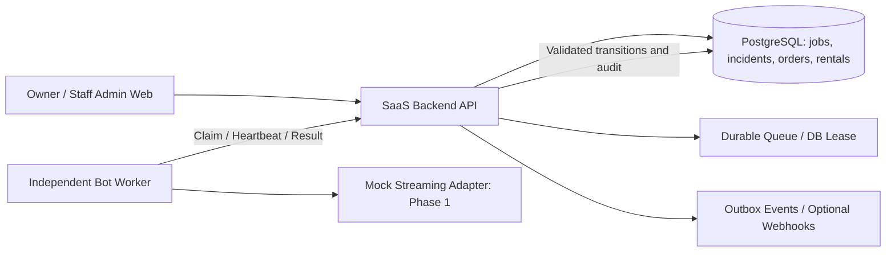

# Streaming Rental SaaS — Bot Control API & Integration Contract
**Version:** `1.0.0-draft` | **Status:** PROPOSED — NOT IMPLEMENTED OR TESTED | **Phase:** 1 (mock-only)
**Audience:** SaaS Backend Team and Independent Bot Worker Team

> This proposed API contract aligns with the approved DB-01–DB-100 baseline and Master Prompt V3. Both teams must review and approve the contract version before integration. The endpoints below are design proposals, not verified running services. The canonical request/response schemas are defined in `openapi.bot-control.v1.yaml`.

## 1. Scope and Architecture



- **Backend owns the source of truth:** jobs, tenants/stores, orders, rentals, reservations, account health, subscription checks, profile state, audit, incidents and fencing tokens.
- **Worker executes tasks only:** claims jobs, sends heartbeats, returns results and evidence. It must not write directly to the SaaS database or mutate orders, rentals, wallets or profiles outside the job-result protocol.
- **Phase 1 uses `MockStreamingProviderAdapter` only.** No real streaming provider access, email reading, profile changes or provider automation. Do not bypass CAPTCHA, MFA, DRM or provider restrictions.
- Phase 2 may introduce authorized integrations behind adapters, preserving `/v1` compatibility or introducing a new version for breaking changes.

## 2. Authentication and Tenant Isolation

- **Admin API:** application session/JWT plus store membership and role-based authorization. Owner, Head Staff and Staff can invoke only permitted operations.
- **Worker API:** preferably OAuth2 client credentials with short-lived JWTs (`aud=bot-worker`) or mTLS. Restrict credentials by worker identity and allowed store scope; never reuse admin tokens.
- A URL `storeId` is a selector, **not proof of authorization**. Enforce server-side authorization and PostgreSQL row-level security.
- `lease_token` is a short-lived secret issued at claim time and supplied on subsequent worker calls. Never log it.
- All mutation requests must include `Idempotency-Key` (UUID recommended) and `X-Request-ID`. Replays with identical payloads return the original result; changed payloads using the same key return HTTP 409.
- Require TLS outside local development. Never include streaming passwords, OTPs, session cookies or customer financial details in job payloads or logs.

## 3. API Endpoint Matrix

| Method | Path | Caller | Purpose |
|---|---|---|---|
| POST | `/v1/stores/{storeId}/bot-jobs` | Authorized Admin | Queue an approved task |
| GET | `/v1/stores/{storeId}/bot-jobs` | Authorized Admin | List jobs, filter and paginate |
| GET | `/v1/stores/{storeId}/bot-jobs/{jobId}` | Authorized Admin | View redacted job details and history |
| POST | `/v1/stores/{storeId}/bot-jobs/{jobId}/cancel` | Authorized Admin | Safely request cancellation |
| POST | `/v1/stores/{storeId}/bot-jobs/{jobId}/retry` | Authorized Admin | Retry under server policy |
| POST | `/v1/worker/jobs/claim` | Worker | Claim a job and receive lease/fencing data |
| POST | `/v1/worker/jobs/{jobId}/start` | Worker | Acknowledge execution start |
| POST | `/v1/worker/jobs/{jobId}/heartbeat` | Worker | Renew the active lease |
| POST | `/v1/worker/jobs/{jobId}/complete` | Worker | Submit outcome and evidence |
| POST | `/v1/worker/jobs/{jobId}/fail` | Worker | Report failure or inconclusive outcome |
| GET | `/v1/worker/jobs/{jobId}` | Worker | Read a job assigned to that worker |

**Schema authority:** `openapi.bot-control.v1.yaml`. The backend must validate against the specification; the worker should generate a typed client from it. Do not infer or invent field names.

## 4. Job Types

| Type | Phase 1 worker behavior (mock) | Backend interpretation |
|---|---|---|
| `VERIFY_LOGIN` | Simulate login-state verification | PASS / FAIL / UNKNOWN |
| `VERIFY_SUBSCRIPTION` | Simulate subscription validity and expiration check | Verification freshness and expiry |
| `VERIFY_PROFILE_READINESS` | Simulate profile readiness | PASS / FAIL / UNKNOWN |
| `HEALTH_CHECK` | Simulate account health assessment | HEALTHY / DEGRADED / BLOCKED / UNKNOWN |
| `RECOVERY_VERIFICATION` | Simulate login, subscription and readiness checks | Recovery PASS after degradation, within 15 minutes |
| `DELIVER_ACCESS` | Simulate access delivery | Verified delivery timestamp or INCONCLUSIVE; mock cannot fulfill production rentals |
| `RECONCILE_DELIVERY` | Investigate uncertain delivery | Delivered / not delivered / unknown |
| `REVOKE_ACCESS` | Simulate revocation after rental expiration | Verified revoked or remain blocked |
| `RECONCILE_REVOCATION` | Investigate uncertain revocation | Revoked / access remains / unknown |

The worker must **not** directly issue `mark_rental_active`, `set_profile_available`, `credit_wallet`, `refund` or `approve_payment`. The backend validates evidence and applies business invariants.

## 5. State Machine, Scheduling and Retries

- Proposed states: `QUEUED → LEASED → RUNNING → SUCCEEDED`; `RUNNING → RETRY_WAIT → QUEUED`; `RUNNING → RECONCILING`; terminal `FAILED`, `DEAD_LETTER` or `CANCELLED` as policy permits.
- Priority: **P1 incidents > P2 delivery > P3 revocation > P4 routine**. Jobs waiting 30 minutes age to at least P2 unless safety/business constraints override.
- **At most four RUNNING jobs per store**, enforced atomically across workers.
- After lease expiry, reject stale worker results. Check both monotonic `fencing_token` and secret `lease_token` transactionally.
- For uncertain outcomes after lease expiry, **fail closed**: block affected resources and schedule reconciliation rather than assuming success or failure.
- Confirmed account lock or invalid subscription → immediately `BLOCKED`. Transient timeout/network failure → at most two retries (three attempts total), preserving allocation hold; then `UNKNOWN`.
- Transient revocation failure → backoff and at most three retries; then create/update an incident and keep `REVOCATION_PENDING`.
- Use exponential backoff with jitter. The server, not the worker, decides retry eligibility, attempt count and priority.

## 6. HTTP Examples

### 6.1 Admin requests subscription verification

```http
POST /v1/stores/11111111-1111-4111-8111-111111111111/bot-jobs
Authorization: Bearer <admin-token>
Idempotency-Key: 9f901ba7-cdb6-4e8a-a3dc-7a97d62a1111
X-Request-ID: req-create-001
Content-Type: application/json

{
  "type": "VERIFY_SUBSCRIPTION",
  "account_id": "22222222-2222-4222-8222-222222222222",
  "reason": "Pre-sale verification"
}
```

**Illustrative HTTP 201 response:**
```json
{
  "id": "33333333-3333-4333-8333-333333333333",
  "store_id": "11111111-1111-4111-8111-111111111111",
  "type": "VERIFY_SUBSCRIPTION",
  "status": "QUEUED",
  "priority": 4,
  "account_id": "22222222-2222-4222-8222-222222222222",
  "created_at": "2026-11-23T05:00:00Z"
}
```

### 6.2 Worker claims a job

```http
POST /v1/worker/jobs/claim
Authorization: Bearer <worker-token>
Idempotency-Key: 73476d63-2a4d-4938-b82e-c01b18c90001
X-Request-ID: req-claim-001
Content-Type: application/json

{"worker_id":"worker-mock-01","capabilities":["VERIFY_SUBSCRIPTION"],"max_jobs":1}
```

**Illustrative HTTP 200 response:**
```json
{
  "job": {
    "id":"33333333-3333-4333-8333-333333333333",
    "store_id":"11111111-1111-4111-8111-111111111111",
    "type":"VERIFY_SUBSCRIPTION",
    "status":"LEASED",
    "priority":4,
    "created_at":"2026-11-23T05:00:00Z"
  },
  "lease_token":"<opaque-secret>",
  "fencing_token":7,
  "lease_expires_at":"2026-11-23T05:02:00Z",
  "execution_context":{"adapter":"MOCK"}
}
```

### 6.3 Worker completes a job

```http
POST /v1/worker/jobs/33333333-3333-4333-8333-333333333333/complete
Authorization: Bearer <worker-token>
Idempotency-Key: 8e8f60fa-3dc1-4d56-bc70-9916b4130001
X-Request-ID: req-complete-001
Content-Type: application/json

{
  "lease_token":"<opaque-secret>",
  "fencing_token":7,
  "worker_id":"worker-mock-01",
  "outcome":"PASS",
  "observed_at":"2026-11-23T05:00:35Z",
  "evidence":{
    "kind":"MOCK",
    "reference":"mock-evidence-001",
    "observed_at":"2026-11-23T05:00:35Z",
    "source":"mock-provider"
  },
  "checks":{"subscription":"PASS"},
  "subscription_expires_at":"2026-12-31T23:59:59Z"
}
```

The backend must retain mock provenance and **never treat mock evidence as live verified evidence or enable real fulfillment based on it**.

### 6.4 Error envelope

```json
{
  "code":"STALE_FENCING_TOKEN",
  "message":"Lease expired or superseded",
  "request_id":"req-abc123",
  "retryable":false
}
```

Suggested codes: `UNAUTHORIZED`, `FORBIDDEN`, `TENANT_SCOPE_DENIED`, `JOB_NOT_FOUND`, `JOB_NOT_CLAIMABLE`, `STALE_FENCING_TOKEN`, `LEASE_EXPIRED`, `INVALID_TRANSITION`, `IDEMPOTENCY_CONFLICT`, `STORE_CONCURRENCY_LIMIT`, `EVIDENCE_REQUIRED`, `PRODUCTION_MOCK_FORBIDDEN`, `RATE_LIMITED`.

## 7. Optional Future Event Contract

Use transactional **outbox events** for downstream notification; webhooks are not the source of truth:

`job.queued`, `job.claimed`, `job.started`, `job.retry_scheduled`, `job.succeeded`, `job.failed`, `job.reconciling`, `job.cancelled`, `incident.opened`, `incident.updated`.

Each event contains `event_id`, `event_type`, `occurred_at`, `store_id`, `job_id`, and `data`. Consumers deduplicate by `event_id`. If webhooks are added, require HMAC signatures, timestamps and replay windows, retries/dead-letter handling, endpoint allowlists and no credentials in payloads.

## 8. Team Responsibilities

| SaaS Backend / Codex Team | Bot Worker Team |
|---|---|
| Implement DB migrations, jobs, attempts, leases, audit and RLS | Generate typed worker client from OpenAPI |
| Implement Admin API and Worker API | Implement claim → start → heartbeat → complete/fail |
| Enforce RBAC, store scope, four-job limit and priority aging | Implement deterministic mock adapter/test fixtures |
| Enforce state transitions, idempotency and fencing | Return PASS/FAIL/INCONCLUSIVE and evidence |
| Atomically update order/rental/profile/incident state | Never write directly to DB or mutate rentals/orders |
| Validate OpenAPI and run provider contract tests | Run mock-server and consumer contract tests |
| Manage secrets, policies and environment separation | Protect scoped worker tokens; never log secrets |

**Contract ownership:** Backend owns `openapi.bot-control.v1.yaml`. Both teams review breaking changes. The endpoint version is `/v1`. Optional additive fields may be backward compatible; renamed fields or changed enum semantics require explicit versioning.

## 9. Contract Acceptance Tests

1. Create → GET → worker claim → complete → admin sees `SUCCEEDED`.
2. Worker lacking store scope cannot claim another store's jobs; Store A admin cannot read Store B jobs.
3. Five competing workers on one store never exceed four simultaneous `RUNNING` jobs.
4. Stale worker completion after lease expiry/fencing change returns 409 with no side effects.
5. Repeated `Idempotency-Key` and identical payload do not duplicate a job/result; changed payload returns 409.
6. Inconclusive delivery does not activate a rental; profile remains blocked and reconciliation is queued.
7. Unverified `REVOKE_ACCESS` never makes a profile `AVAILABLE`.
8. Stale or pre-degradation PASS does not satisfy recovery verification.
9. Invalid subscription blocks the account and opens an incident; transient timeouts follow retry policy then become UNKNOWN.
10. Mock results cannot authorize production fulfillment.
11. Worker crash and missing heartbeat cause lease expiry/reconciliation without duplicate effects.
12. Every mutation has correct audit trail, evidence references, request IDs and tenant isolation.

## 10. Integration Plan

1. Both teams freeze the **same** `openapi.bot-control.v1.yaml` revision.
2. Backend provides mock API server, Swagger UI and test-only worker authentication.
3. Worker team generates a typed client and develops a mock executor in its own repository.
4. CI runs schema-based contract tests and negative/security cases.
5. Integrate with Docker Compose and run two-store E2E plus race-condition tests.
6. Jointly approve the contract version before staging deployment.

**Important:** These paths, field names, JSON examples, job states and token conventions are proposed integration details, not necessarily direct requirements of DB-01–DB-100. Reconcile them against the actual implementation while preserving the approved business invariants.

